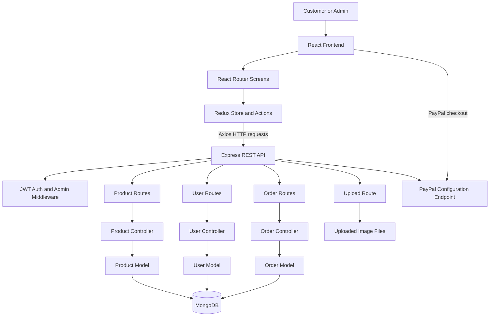

# The Bookmark - Online Bookstore

The Bookmark is a full-stack online bookstore built using MongoDB, Express.js, React, and Node.js. It allows customers to browse books, search for products, read and submit reviews, manage their shopping cart, and place orders. The application also includes an admin section for managing products, users, and orders.

## Features

### Storefront

- Browse books and view product details.
- Search books by name and browse paginated results.
- View top-rated products.
- Add books to the cart and update quantities.
- Register, log in, and update user profile information.
- Submit product ratings and reviews.
- Enter shipping details and select a payment method during checkout.
- View order history and individual order details.
- Make payments through PayPal integration.

### Admin Panel

- Add, update, and delete products.
- View and manage registered users.
- View customer orders and mark orders as delivered.
- Upload product images.

### Backend and Security

- Hash passwords using bcryptjs.
- Use JSON Web Tokens (JWT) for authentication.
- Protect routes using authentication and admin middleware.
- Store application data in MongoDB using Mongoose.
- Handle missing routes and application errors through middleware.

## Technologies Used

| Area | Technologies |
|---|---|
| Frontend | React 17, React Router 5, React Bootstrap |
| State Management | Redux, Redux Thunk |
| HTTP Requests | Axios |
| Backend | Node.js, Express.js |
| Database | MongoDB, Mongoose |
| Authentication | JWT, bcryptjs |
| Payments | PayPal React button integration |
| File Uploads | Multer |

## Application Architecture

The application has a React frontend and an Express.js backend. The frontend uses Redux to manage application state and Axios to communicate with the REST API.

The backend handles requests through routes and controllers. Mongoose models manage data stored in MongoDB. Authentication middleware verifies JWTs and checks admin permissions for protected operations. The backend also provides endpoints for image uploads and PayPal configuration.



## Project Structure

```text
The_Bookmark/
├── backend/
│   ├── controllers/      # Product, user, and order logic
│   ├── data/             # Sample data
│   ├── middleware/       # Authentication and error handling
│   ├── models/           # Mongoose models
│   ├── routes/           # API routes
│   ├── utils/            # Database connection and JWT helpers
│   ├── seeder.js         # Import or remove sample data
│   └── server.js         # Backend entry point
├── frontend/
│   ├── public/           # Static assets
│   └── src/
│       ├── actions/      # Redux actions
│       ├── components/   # Reusable UI components
│       ├── reducers/     # Redux reducers
│       └── screens/      # Application pages
├── package.json
└── README.md
```

## Prerequisites

Before running the project, install the following:

- [Node.js and npm](https://nodejs.org/)
- MongoDB installed locally or a MongoDB Atlas account
- A PayPal developer account and client ID to test PayPal checkout

## Getting Started

### 1. Clone the Repository

Replace the repository URL with your GitHub repository URL.

```bash
git clone <your-repository-url>
cd The_Bookmark
```

### 2. Install Dependencies

Run the following commands from the project root:

```bash
npm install
npm install --prefix frontend
```

### 3. Configure Environment Variables

Create a `.env` file in the project root, alongside the root `package.json`.

```env
NODE_ENV=development
PORT=5000
DB_URI=mongodb://127.0.0.1:27017/the_bookmark
JWT_SECRET=replace_with_a_long_random_secret
PAYPAL_CLIENT_ID=your_paypal_client_id
```

Update the values as follows:

- `DB_URI`: Your MongoDB connection string.
- `JWT_SECRET`: A long, randomly generated secret used for signing JWTs.
- `PAYPAL_CLIENT_ID`: Your PayPal sandbox client ID for development or live client ID for production.

Keep your `.env` file private. Do not commit credentials or API secrets to GitHub.

### 4. Run the Application

Start the backend and frontend together:

```bash
npm run dev
```

The frontend normally runs at `http://localhost:3000`, and the backend API runs at `http://localhost:5000`.

You can also run each part separately in two terminal windows.

Terminal 1 - Backend:

```bash
npm run server
```

Terminal 2 - Frontend:

```bash
npm run client
```

### 5. Load Sample Data

If you want to populate the database with the sample data included in the project, run:

```bash
npm run data:import
```

To remove the seeded data, run:

```bash
npm run data:destroy
```

**Note:** The destroy command deletes data. Check the seeder implementation and confirm the database connection before running it.

## API Overview

The backend exposes REST API endpoints under `/api`.

| Endpoint | Description | Access |
|---|---|---|
| `GET /api/products` | List and search products with pagination | Public |
| `GET /api/products/top` | Retrieve top-rated products | Public |
| `GET /api/products/:id` | Retrieve product details | Public |
| `POST /api/products/:id/reviews` | Submit a product review | Authenticated |
| `POST /api/users` | Register a new user | Public |
| `POST /api/users/login` | Log in and receive a JWT | Public |
| `GET /api/users/profile` | Retrieve the current user's profile | Authenticated |
| `POST /api/orders` | Create an order | Authenticated |
| `GET /api/orders/myorders` | Retrieve the current user's orders | Authenticated |
| `GET /api/orders/:id` | Retrieve order details | Authenticated |
| `POST /api/upload` | Upload a product image | Depends on route configuration |

Additional endpoints support product management, user administration, and order management. Their access requirements and HTTP methods can be found in the route files under `backend/routes/`.

## Available Scripts

Run these commands from the project root.

| Command | Description |
|---|---|
| `npm run dev` | Run the backend and frontend together |
| `npm run server` | Start the backend using Nodemon |
| `npm run client` | Start the React frontend |
| `npm start` | Start the backend |
| `npm run data:import` | Import sample data |
| `npm run data:destroy` | Remove seeded data |

For frontend-specific commands, change to the `frontend` directory:

```bash
cd frontend
npm start
npm test
npm run build
```

## Additional Notes

- The frontend development proxy points to `http://127.0.0.1:5000`.
- Uploaded product images are served through the backend's `/uploads` path. Ensure the upload directory exists and is writable.
- PayPal checkout requires a valid client ID configured in the environment.
- Before deploying the application, test authentication, admin permissions, product uploads, order processing, and payment flows in the target environment.

## Contributing

Contributions and suggestions are welcome.

1. Fork the repository.
2. Create a branch for your changes.

   ```bash
   git checkout -b feature/your-feature
   ```

3. Make your changes and test them.
4. Commit your changes with a descriptive message.
5. Push your branch and open a pull request.

## License

This project uses the ISC license, as specified in the root `package.json`.